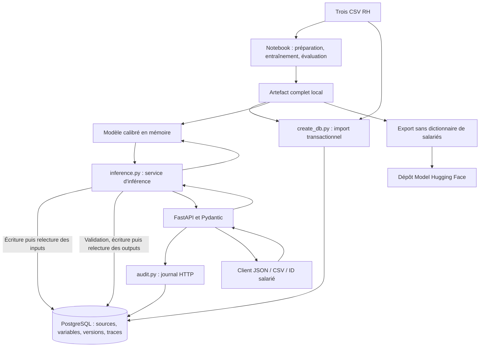

# Architecture et choix techniques

## Composants

L'entraînement est réalisé dans le notebook. Toutes les inférences exposées par l'API
passent par le service transactionnel et PostgreSQL. La publication Hugging Face
est une étape de distribution du modèle, indépendante du service API local.

## Répartition du code

| Fichier | Responsabilité |
| --- | --- |
| `api.py` | Routes, traitement multipart/CSV, middleware HTTP et réponses d'erreur |
| `schemas.py` | Contrats Pydantic pour les entrées et sorties, validation en contexte des variables |
| `inference.py` | Enregistrement et relecture des inputs, calcul, validation et persistance des outputs |
| `audit.py` | Messages, durées, étapes, contexte et résumé des échanges |
| `database.py` | Modèles ORM et connexion PostgreSQL |
| `create_db.py` | Création des tables, migrations disponibles et import des trois sources |
| `scripts/local_postgres.py` | Instance locale, droits, démarrage, arrêt et recréation avec sauvegarde |
| `scripts/publish_huggingface.py` | Export à clés autorisées et publication contrôlée |
| `scripts/verify_database.py` | Vérification des sources et du circuit réel API/BDD |
| `dataScientistTechNova.ipynb` | Analyse, transformations, comparaison, optimisation, calibration et export |

## Choix et compromis

**FastAPI et OpenAPI** rendent les contrats explorables dans Swagger et ReDoc.
**Pydantic** refuse les données non conformes et valide les résultats avant leur
enregistrement. Il ne remplace ni la préparation des variables ni une évaluation
statistique de la qualité du modèle.

**SQLAlchemy** centralise les tables et transactions. **PostgreSQL** garantit les
clés étrangères et l'unicité des lignes d'une requête. Les sources métier restent
dans des tables typées ; **JSONB** accueille les variables et résultats dont la
structure dépend du modèle. L'index de ligne conserve l'ordre d'un fichier.

Les inputs sont committés avant le calcul. Cette séparation conserve les données
d'une tentative ayant échoué et permet de vérifier que le modèle lit réellement
les valeurs stockées. Les outputs validés sont committés avant la réponse HTTP.
Ce circuit privilégie la traçabilité et ajoute plusieurs accès BDD par requête.

**Joblib et scikit-learn** conservent l'objet calibré et ses paramètres. Le chargement
est réservé à un fichier local de confiance et doit utiliser des versions compatibles.
Le SHA-256 identifie le fichier exact ; il ne prouve pas son origine.
L'artefact ne contient pas une pipeline autonome de transformation des données brutes.

**uv et son verrou** rendent les environnements reproductibles. **GitHub Actions**
vérifie tests et package avant publication. **MkDocs** réutilise les fichiers Markdown
existants pour fournir navigation, recherche et diagrammes sans entretenir un second
format Sphinx en parallèle.

## Contrôle des échanges

L'identifiant `X-Request-ID` relie le journal HTTP, les inputs ordonnés, le modèle
utilisé et les sorties. La [documentation PostgreSQL](database.md) contient le
schéma relationnel et la séquence détaillée. La vue `api_logs` facilite la lecture.

Si la BDD est hors service, l'API renvoie 503 avant le calcul : cet échec initial
ne peut pas être enregistré dans cette BDD et apparaît dans les logs du processus.
Un arrêt brutal peut laisser une trace `pending`. Le système ne fournit pas de
garantie « exactement une fois » : réenvoyer une requête crée un nouvel échange
et peut refaire le calcul. Il n'y a pas de journal de chaque instruction SQL ni
de mécanisme automatique de reprise des requêtes interrompues.
