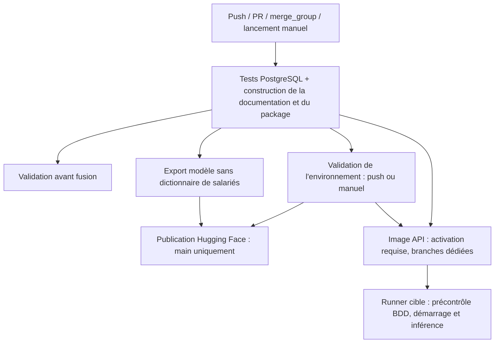
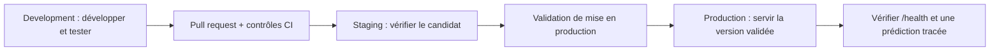

# Déploiement local et intégration continue

## État du déploiement

| Composant | Fonctionnement disponible |
| --- | --- |
| API FastAPI | Processus local sur `127.0.0.1:8000` |
| PostgreSQL | Instance dédiée sur `127.0.0.1:5433`, base `hrnova` |
| Documentation MkDocs | Serveur de prévisualisation sur `127.0.0.1:8001` ou fichiers statiques construits |
| GitHub Actions | Tests, documentation, package, publication du modèle et déploiement API activable sur runners dédiés |
| Hugging Face | Dépôt Model `SamGabb/hrnova`, pas un Space API déployé par ce workflow |

## Lancer un service local

Suivre [l'installation](installation.md), puis lancer l'API depuis la racine du dépôt :

```bash
uv sync --locked --extra api
uv run --no-sync python scripts/local_postgres.py start
uv run --no-sync uvicorn api:app --host 127.0.0.1 --port 8000
```

`--reload` est utile en développement, mais n'est pas utilisé pour un service stable.
Le modèle est chargé à la première consultation qui le nécessite et mis en cache
dans chaque processus. Remplacer le fichier nécessite donc un redémarrage de l'API.
Le serveur PostgreSQL doit être redémarré après un redémarrage du Mac si aucun service
système n'a été configuré ; `local_postgres.py start` s'en charge.

Le projet fournit un Dockerfile et une configuration Compose pour exécuter l'API
sur des machines préparées. Le reverse proxy, le TLS et l'authentification HTTP
restent à configurer pour une exposition publique. La BDD doit être accessible
depuis le conteneur. `127.0.0.1` depuis un conteneur désigne ce conteneur, pas le
PostgreSQL du Mac ; les modèles de configuration utilisent `host.docker.internal`.

## Pipeline GitHub Actions

Le fichier `.github/workflows/ci.yml` réagit aux push, pull requests, groupes de fusion
et lancements manuels. Python 3.13 et `uv.lock` fixent l'environnement.



Le job de tests utilise PostgreSQL 18 avec un schéma isolé par test. Les rapports
JUnit et de couverture, le package, la documentation HTML et l'export du modèle
sont conservés dans les artefacts GitHub pendant 14 jours.
Les tests ne réentraînent pas le modèle ; ils contrôlent les routes et la traçabilité.
Le test d'import utilise aussi le dataset complet et l'artefact local.

La documentation est construite avec `mkdocs build --strict` : un lien interne
invalide ou un document de navigation manquant fait échouer cette vérification.
La construction produit un artefact HTML, sans publier automatiquement un site public.

## Protection avant fusion

Après une première exécution, configurer un ruleset ou une protection de branche
dans les réglages GitHub pour `main` et `develop` :

1. Exiger une pull request avant fusion.
2. Exiger le contrôle **Validation avant fusion**.
3. Exiger une branche à jour avant la fusion.
4. Appliquer la règle aux administrateurs et limiter les possibilités de contournement.

Ces paramètres sont gérés dans GitHub ; le YAML seul ne peut pas empêcher une fusion.
Un commit resté uniquement local ne déclenche pas GitHub Actions.

## Environnements

Un **environnement de déploiement** est un ensemble cohérent : une instance de
l'API, sa configuration, une base PostgreSQL et une version du modèle. Le code
peut être identique entre environnements ; les adresses, accès et données sont
propres à chacun. Un environnement GitHub organise les variables, secrets et
protections des jobs qui le ciblent. Il ne crée pas à lui seul de serveur API.

### Rôle de chaque environnement

| Environnement | Objectif | Données et configuration attendues lors d'un déploiement |
| --- | --- | --- |
| `development` | Développer et déboguer rapidement | API locale, données de test, base de développement |
| `staging` (préproduction) | Répéter la mise en service et les tests d'intégration | Instance et base distinctes, données synthétiques ou anonymisées, configuration proche de la production |
| `production` | Servir la version validée aux utilisateurs | Instance stable, base dédiée, accès limités et secrets propres à la production |

Les noms de bases `hrnova_dev`, `hrnova_staging` et `hrnova_prod` peuvent servir
de convention pour de futures instances. **Ces trois bases ne sont pas créées par
la pipeline actuelle** ; l'installation locale existante utilise `hrnova`.

### Parcours d'une version



Ce schéma décrit le protocole de promotion cible. Pour un déploiement reproductible, promouvoir
les mêmes artefacts de code et de modèle, identifiés par leur commit Git et leur
SHA-256, après validation en préproduction. Une fusion pouvant modifier le code,
vérifier que le candidat testé correspond bien à la version publiée. Une évolution
du modèle doit aussi être enregistrée dans la base de chaque environnement avant
de l'utiliser. Le [guide de maintenance](maintenance.md) détaille la mise à jour.

### Configuration séparée

| Paramètre | Séparation attendue |
| --- | --- |
| `DATABASE_URL` | Base et rôle applicatif propres à l'environnement ; ne jamais utiliser la base de production pour les tests |
| `HRNOVA_MODEL_PATH` | Fichier du modèle validé pour cette version, présent sur la machine de l'API |
| `HF_TOKEN` | Secret du job de publication ; inutile au processus API local |
| `HF_REPO_ID` | Destination de publication du modèle ; le dépôt Model n'est pas un serveur FastAPI |
| URL de l'API | Adresse propre à l'instance ; elle dépend de l'hébergement effectivement configuré |

Exemple de démarrage d'une **instance de préproduction déjà provisionnée** :

```bash
# .env.staging contient DATABASE_URL et HRNOVA_MODEL_PATH, sans être versionné.
uv run --no-sync uvicorn api:app --env-file .env.staging --host 127.0.0.1 --port 8002
```

Le fichier doit désigner une base existante, initialisée avec les tables, les
droits applicatifs et la version du modèle. Cette commande lance un processus
local ; elle ne provisionne pas la base et ne configure pas de service permanent.
Les variables déjà exportées dans le terminal prennent priorité sur le fichier :
utiliser un terminal ou un service dont la configuration correspond à la cible.
Le port `8002` est un exemple, pas une instance déjà disponible.

Avant une mise en production, sauvegarder la base et identifier la version
précédente du code et du modèle. Après redémarrage, vérifier `/health`, puis une
inférence et sa trace en BDD. En cas d'échec, revenir à la version précédente ;
une migration de schéma exige son propre plan de compatibilité ou de restauration.

### Correspondance avec GitHub Actions

| Branche lors d'un push ou d'un lancement manuel | Environnement GitHub |
| --- | --- |
| Branches de travail | `development` |
| `develop` | `staging` |
| `main` | `production` |

Créer ces environnements dans **Settings → Environments**, limiter `staging` à
`develop` et `production` à `main`. Une approbation de production peut être activée
si le dépôt permet cette option. Les pull requests n'accèdent pas à ces environnements.
Le job de publication utilise lui aussi `production` et peut donc demander une
approbation distincte.

Le job d'environnement utilise une BDD de test éphémère et vérifie la configuration
`HRNOVA_MODEL_PATH` puis les tests. Le déploiement effectif est assuré par les jobs
`build-api-image` et `deploy-api` lorsqu'ils sont activés, selon la procédure ci-dessous.

## Activer le déploiement API dans GitHub Actions

### Préparer les machines et les bases

Prévoir des machines Linux x64 avec Docker Engine, Docker Compose V2 (avec
`up --wait`), Python 3 et un runner GitHub installé comme service. Le compte du
runner doit pouvoir utiliser Docker. Affecter un label propre à chaque cible :

| Branche autorisée au déploiement | Environnement | Label du runner | Port par défaut sur l'hôte |
| --- | --- | --- | --- |
| `development` | `development` | `hrnova-development` | `8000` |
| `develop` | `staging` | `hrnova-staging` | `8002` |
| `main` | `production` | `hrnova-production` | `8003` |

Les branches libres et les pull requests passent les tests, mais ne déploient
pas l'API. Les runners de déploiement doivent être réservés aux workflows de
confiance ; ne pas y exécuter du code de pull request non approuvé.

Créer et initialiser une base PostgreSQL par cible avec `create_db.py`, les trois
sources CSV et l'artefact complet, comme décrit dans le [guide BDD](database.md).
Créer les tables et appliquer les migrations avec le rôle d'administration,
puis utiliser le rôle applicatif limité pour l'API. Cette étape est explicite :
le job de déploiement ne crée pas de base, n'applique pas de migration et ne
réimporte pas automatiquement le dataset de production. Toute nouvelle version
du modèle doit être enregistrée dans la base avant sa mise en service.

La connexion doit fonctionner **depuis un conteneur**. Sur Docker Desktop,
`host.docker.internal` désigne la machine hôte. Sur Linux, Compose ajoute ce nom
via `host-gateway` ; PostgreSQL doit écouter sur une interface joignable depuis
le réseau Docker et autoriser ce réseau dans `pg_hba.conf`. Un serveur écoutant
uniquement sur `127.0.0.1` n'est pas joignable via la passerelle Linux.

### Configurer GitHub

Dans **Settings → Environments**, créer les trois environnements et définir :

| Type | Nom | Contenu |
| --- | --- | --- |
| Secret de chaque environnement | `DATABASE_URL` | URL `postgresql+psycopg://…` de sa base, avec le rôle applicatif |
| Variable facultative | `API_PORT` | Port de l'API sur l'hôte, sinon valeur du tableau ci-dessus |
| Variable facultative | `API_BIND_HOST` | `127.0.0.1` par défaut ; adapter seulement à l'exposition prévue |

Restreindre les branches : `development` pour l'environnement de développement,
`develop` pour staging et `main` pour production. Configurer une approbation de
production si cette fonctionnalité est disponible pour le dépôt. Les jobs de
publication Hugging Face et de déploiement API sont indépendants et peuvent
chacun déclencher cette protection.

Après préparation des cibles, définir la **variable de dépôt**
`ENABLE_API_DEPLOYMENT` à `true` dans **Settings → Secrets and variables → Actions →
Variables**. Elle est désactivée par défaut pour que les jobs n'attendent pas
des runners absents. Un push sur une branche du tableau, ou un lancement manuel
du workflow sur cette branche, exécutera les tests puis le déploiement.

L'URL effective reste celle de la machine cible et de son exposition réseau.
Le workflow ne crée ni domaine public ni URL Hugging Face pour FastAPI.

### Étapes réellement exécutées

1. Les tests, la construction du package et la validation d'environnement réussissent.
2. GitHub construit une image Linux x64 depuis ce même commit et `uv.lock`, puis
   la transmet sous forme d'artefact `api-image-<SHA>` au runner cible.
3. Le runner charge cette image, identifiée par `hrnova-api:<SHA>`.
4. Un conteneur temporaire vérifie en lecture seule la connexion, les tables de
   traçabilité et les métadonnées du modèle enregistré. Un échec laisse l'API
   courante intacte.
5. Compose remplace le service `hrnova-<environnement>-api` et attend `/health`.
6. Une prédiction synthétique `/predict` est exécutée et son `X-Request-ID` contrôlé.
   Ce test crée volontairement un échange traçable dans la base cible.
7. En cas d'échec après remplacement, le script tente de restaurer l'ID immuable
   de l'image précédente. Au premier déploiement, il arrête l'instance défaillante.

Le remplacement peut causer une brève interruption ; ce mécanisme ne garantit
pas un déploiement sans interruption. Le retour arrière restaure l'image du code
et du modèle avec la configuration du lancement courant : il ne restaure pas
une ancienne valeur de secret ou le schéma de la base. Si le rollback échoue,
le job le signale explicitement et demande une intervention. Les push suivants
n'annulent pas un déploiement en cours ; ils attendent leur tour.

L'image contient l'artefact complet de confiance, qui inclut des variables par
salarié. Elle est transmise comme artefact GitHub pendant trois jours, sans envoi
à un registre public. Réserver l'accès au dépôt, aux artefacts et aux runners aux
personnes autorisées. L'export public Hugging Face reste séparé et épuré.

### Exécution manuelle sur une machine préparée

Exemple pour staging ; adapter le fichier selon l'environnement :

```bash
cp deployment/staging.env.example .env.staging
# Renseigner DATABASE_URL dans .env.staging, avec une base initialisée.
docker build --tag hrnova-api:local .
uv run --no-sync --env-file .env.staging python scripts/deploy_api.py \
  --environment staging --image hrnova-api:local
```

Les modèles `deployment/development.env.example`, `staging.env.example` et
`production.env.example` ne contiennent aucun secret réel. La valeur
`CHANGE_ME` est refusée par le script. Les fichiers `.env.*` restent ignorés par
Git. Le script ne journalise pas la chaîne de connexion ; consulter les logs
sur la machine cible pour les diagnostics détaillés.

```bash
docker compose --env-file .env.staging --project-name hrnova-staging \
  --file deployment/compose.yml ps
docker compose --env-file .env.staging --project-name hrnova-staging \
  --file deployment/compose.yml logs --tail 50 api
curl http://127.0.0.1:8002/health
```

Après un déploiement CI, renseigner `HRNOVA_IMAGE=hrnova-api:<SHA>` dans le fichier
local avant d'utiliser ces commandes Compose. Ne pas utiliser `docker compose
config` dans des logs partagés : sa sortie résolue inclut les secrets.

## Publication du modèle

Le [guide Hugging Face](huggingface.md) décrit le secret `HF_TOKEN`, la variable
facultative `HF_REPO_ID` et les quatre fichiers envoyés. La publication attend
la réussite des tests et de la validation d'environnement ; elle concerne `main`.
Le token n'est nécessaire qu'à la publication, pas aux tests ni à la construction
de la documentation. Les artefacts sont reliés au commit Git source.

Mettre à jour le dépôt Model ne recharge pas automatiquement l'API locale ni
les variables déjà importées dans PostgreSQL. Suivre le [protocole de mise à jour](maintenance.md).

Références : [protections de branches GitHub](https://docs.github.com/en/repositories/configuring-branches-and-merges-in-your-repository/managing-protected-branches/about-protected-branches),
[environnements GitHub](https://docs.github.com/en/actions/reference/workflows-and-actions/deployments-and-environments)
et [configuration MkDocs](https://www.mkdocs.org/user-guide/configuration/).
